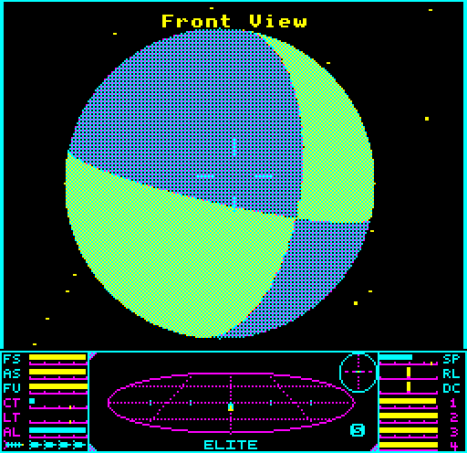
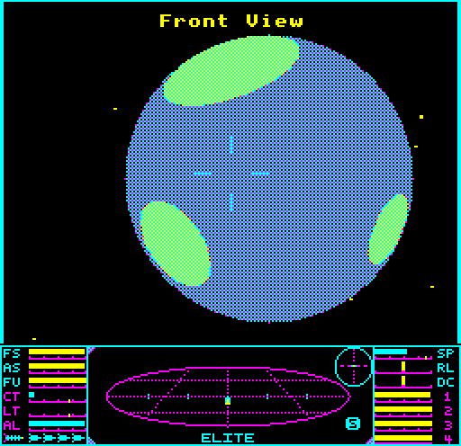
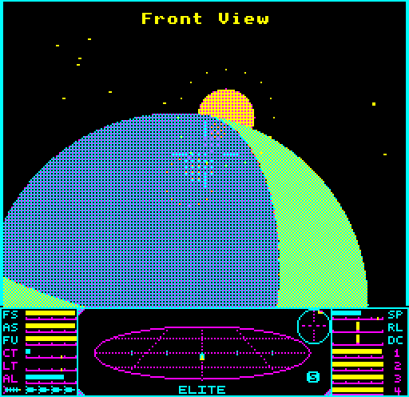
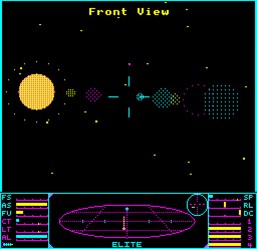
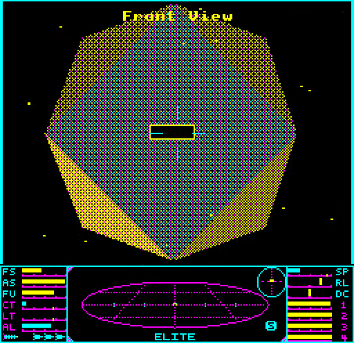
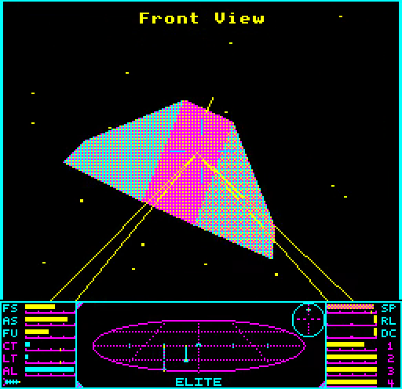

# Solid Elite for the 6502 Second Processor

A version of [Solid Elite for the BBC Master](https://github.com/ebenupton/solid-elite-bbc-master) (Acornsoft's BBC Master Elite with solid, sunlit ships instead of wireframes) for the 6502 Second Processor. The whole game runs on the second processor (the "parasite", a 65C02 with a flat 64K of memory); the BBC Micro it is attached to (the "host") only draws what it is told and does the I/O. It runs with a BBC Master 128 or a BBC Micro Model B as the host. Like the Master port, it is built on, and would not exist without, [Mark Moxon](https://github.com/markmoxon)'s [fully documented source code for BBC Master Elite](https://github.com/markmoxon/elite-source-code-bbc-master).

<p align="center">

<br>
<em>A meridian planet as a beach ball: two great circles, projected exactly, split the disc into land and sea, and spin as the original's equator and meridian do.</em>
</p>

What's new:

* **Everything in the Master port, on a second processor.** Solid ships lit by the sun; solid planets drawn by one circle engine (beach balls for meridian planets, true spherical craters for crater planets); solid suns with a lens flare, still drawn near the planet where the original drops the sun for the space station; a double-buffered, flicker-free four-colour screen at up to 25 frames a second; the new dashboard; kept solid rows when docking; the solid hangar and briefing ship. Every frame the Tube version draws is pixel for pixel the Master port's.
* **The original game, exactly.** The game logic is Acornsoft's: given the same keypresses, the Tube version plays out the same game as the original, iteration for iteration, and its save files are byte-identical with the original's.
* **Every disc incremental.** Each screen buffer remembers what it shows of every row of the planet and the sun; each frame sends the host only what changed. An edge that moved is sent as the strip it moved through, and an unchanged row costs the parasite a few compares. The planet's surface and a second disc (the sun beside the planet) are remembered in one disc heap on the parasite.
* **The host is a dumb renderer.** It draws lines, points, spans, text and the dashboard; it does the keyboard, sound, disc, vsync and the buffer flip; and it stores the parasite's overlay images and its own star records. Everything that decides what to draw (the game, the 3D maths, the rasteriser's bookkeeping, the planets' surfaces, the flare, the text) is on the parasite, so the two processors work in parallel: the parasite works out the next frame while the host draws this one.
* **Two hosts.** A BBC Master fills spans through straight-line store runs in its sideways RAM. A Model B with 64K of sideways RAM keeps a set of row runs per screen buffer, and splits the 3D view from the dashboard with a CRTC vertical rupture (two CRTC frames a field, set up by a timer interrupt).

<p align="center">



<br>


<br>
<em>A crater planet with three craters; the sun rising behind the planet's limb, the lens flare turned down where the planet covers it; the sun and its full flare; a Coriolis station; combat. (Screenshots of the Master port, whose frames the Tube version draws pixel for pixel.)</em>
</p>

## Playing it

| Disc | Host | Second processor |
|---|---|---|
| [solid-elite-tube-master.ssd](solid-elite-tube-master.ssd) | BBC Master 128 | a 6502 Second Processor, or the Master's internal 65C102 co-processor (4 MHz) |
| [solid-elite-tube-modelb.ssd](solid-elite-tube-modelb.ssd) | BBC Micro Model B with 64K of sideways RAM (four banks) | a 6502 Second Processor (3 MHz) |

Attach the second processor (on a Master, the internal co-processor works), load the disc and press SHIFT-BREAK. The game plays as BBC Master Elite does: the same keys, the same saved commanders. BREAK during play does not recover yet; a cold SHIFT-BREAK boot is fine. In an emulator, choose a Master 128 or a Model B with a 6502 second processor (and, for the Model B, sideways RAM in four banks). For a BBC Master with no second processor, play the [Master port](https://github.com/ebenupton/solid-elite-bbc-master) itself.

## Building it

```
sh master/build.sh && sh tube/build.sh
```

This builds `tube/build/elite-tube.ssd` (Master host), `tube/build/elite-tube-b.ssd` (Model B host) and `master/build/elite-master-sng47.ssd` (the Master port); the two discs in the root are copies of the Tube ones. You need Python 3; BeebAsm is in `tools/` (a macOS arm64 binary; elsewhere set `BEEBASM` to your own build of BeebAsm 1.11). Nothing else is needed to build.

## The layout

The parasite holds the whole game at the Master port's addresses, the frame layer and the rasteriser's bookkeeping, in a flat 64K: zero page and the game's workspaces to `&0CCE`, the frame layer's inputs to `&13FF`, resident code and data from `&1400`, then an overlay region from `&B400` and a four-page command ring from `&F400`. Two overlays share the overlay region: **S** for the space view (the rasteriser's bookkeeping, the discs, the planet's surface, the lens flare, the text overlay, and the disc heap in its saved state) and **D** for the screens drawn directly (the charts, the market, equipment, status and the disc menu, the title). The host keeps both images and swaps them in only when the game changes between the space view and a docked screen. The parasite streams its commands to the host through the Tube's register 1, buffered in the ring while the host is busy and drained by interrupt.

The Master host keeps the Master port's screen (two buffers at `&4000`, one in shadow RAM, and the dashboard in shadow `&7000`) and fills spans with 37.6K of straight-line `STA` runs in sideways RAM. The Model B host puts the buffers at `&1000` and `&4000` and the dashboard at `&7000`, its code in four sideways RAM banks, and borrows a little main RAM from the MOS, swapping it back for each disc command. [docs/TUBE-MAP.md](docs/TUBE-MAP.md) has the details: both hosts' maps, the parasite's, and the protocol.

## Speed

Main-loop iterations per emulated second over windows of one recorded game: flight (iterations 1000-1400), docking (3420-3550), the first 3,550 iterations, and two approaches to a beach-ball planet (300-403 and 5355-5457). The original is Acornsoft's SNG47 on a BBC Master, with wireframe ships and planets; the Master port and the Tube versions draw solid, double-buffered frames, capped at 25 frames a second.

| | Flight | Docking | 0-3550 | Beach 300-403 | Beach 5355-5457 |
|---|---:|---:|---:|---:|---:|
| Original (SNG47, BBC Master, wireframe) | 12.69 | 12.61 | 14.38 | 8.11 | 9.09 |
| Master port (BBC Master, no second processor) | 12.30 | 7.05 | 13.66 | 6.46 | 5.84 |
| Tube, Master host, 4 MHz second processor | 21.31 | 10.68 | 20.27 | 10.34 | 10.20 |
| Tube, Model B host, 3 MHz second processor | 17.54 | 10.08 | 17.96 | 8.56 | 8.13 |

With the Master as host, the Tube version runs at 1.5 to 1.75 times the Master port's speed, and is faster than the original everywhere but docking, where the solid station fills much of the screen. In flight and on the planets the parasite sets the pace, and the host is idle a third to a half of the time; at docking the host does. With the same parasite clock (3 MHz) and the same fill routines, the Model B host is within 0.4% of the Master host: the rest of the Model B's work is its split-screen interrupt and its NMOS code.

## Testing

Every change was checked against Acornsoft's release (SNG47) and against the Master port:

* **The gate** (`sh tube/tools/tgate.sh DIR`, on both hosts) runs the recorded game for 16,002 iterations in lockstep with SNG47, comparing the game state at every iteration; requires every frame and the dashboard to be pixel-identical with the Master port's; saves and loads commanders and compares the files byte for byte with the original's; and checks a crash, the station, the overlay storage, the internal co-processor, and the speeds above.
* **Posed scenes** (`sh tube/tools/tscenes.sh DIR`): 13 planet and sun scenes compared frame by frame with the Master port, with no disc row dropped or drawn whole; `tube/tools/tdrows.mjs` checks every disc row the parasite sends against what the row must show.

The tests need files that are not in this repository, which you must supply:

* `master/reference/sng47/` and `master/reference/elite-master-sng47.ssd`: the released SNG47 binaries and disc (Acornsoft's; the lockstep's and the save tests' reference);
* `scratch/curious/run1/` (`config.json`, `inputs.jsonl`): the input log of the recorded game, made with `master/tools/agentplay` against SNG47;
* `scratch/master-ref.ssd` (a copy of `master/build/elite-master-sng47.ssd`) and the pixel references `scratch/fbref` and `scratch/dashref`, made from it with `master/tools/agentplay/fbreplay.mjs` over the same log.

They need Node.js and jsbeeb.

## Credits

* **Elite** was written by **Ian Bell and David Braben** and is copyright &copy; Acornsoft 1986.

* **The source code this is built on** is **Mark Moxon**'s reconstruction of BBC Master Elite from a disassembly of the original binaries, with every line documented and explained. The commentary is copyright &copy; Mark Moxon. See his [elite.bbcelite.com](https://elite.bbcelite.com) for the full story of how Elite works.

* **The Master port** this builds on is [Solid Elite for the BBC Master](https://github.com/ebenupton/solid-elite-bbc-master).

* **The Tube version** is by Eben Upton, written with [Claude Code](https://claude.com/claude-code).

* **Regression testing** used **Dom Pajak**'s [elite-agent](https://github.com/8bitkick/elite-agent), a rule-based Elite player, whose play recorded the game the gates replay.

This is an independent project. It is not affiliated with or endorsed by Mark Moxon, Ian Bell, David Braben or Acornsoft. As with Mark's repository, the original game and Mark's commentary are copyright, and no licence is granted.

## Documentation

[docs/TUBE-MAP.md](docs/TUBE-MAP.md): the memory maps of both hosts and the parasite, and the host/parasite protocol. [TUBE-REPORT.md](TUBE-REPORT.md): the measurements and experiments. [docs/TUBE-PLAN.md](docs/TUBE-PLAN.md): the plan. [docs/MASTER-PLAN.md](docs/MASTER-PLAN.md): the Master port.
