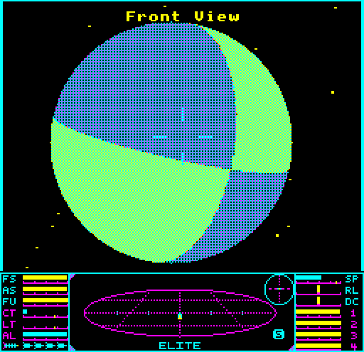
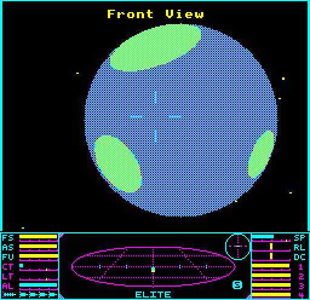
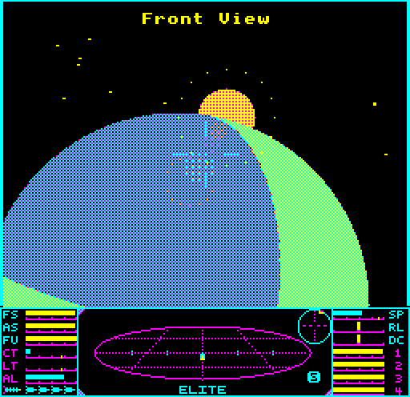
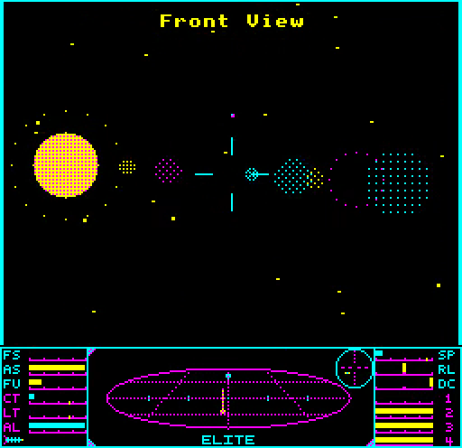
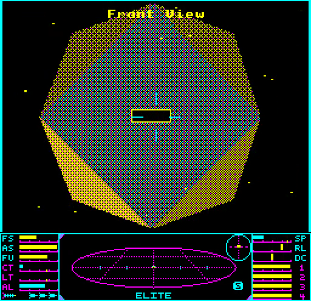
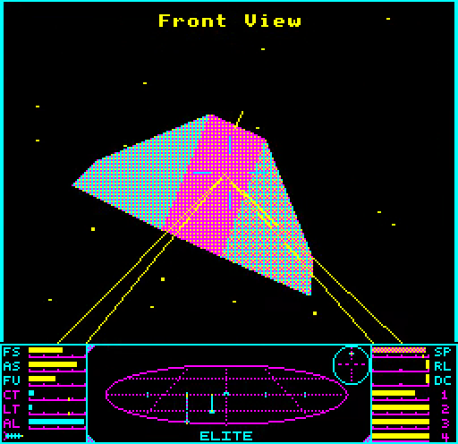

# Solid Elite for the 6502 Second Processor

A version of [Solid Elite for the BBC Master](https://github.com/ebenupton/solid-elite-bbc-master) (Acornsoft's BBC Master Elite with solid, sunlit ships instead of wireframes) for the 6502 Second Processor. The whole game runs on the second processor (the "parasite", a 65C02 with a flat 64K of memory); the BBC Micro it is attached to (the "host") only draws what it is told and does the I/O. It runs with a BBC Master 128 or a BBC Micro Model B as the host. Like the Master port, it is built on, and would not exist without, [Mark Moxon](https://github.com/markmoxon)'s [fully documented source code for BBC Master Elite](https://github.com/markmoxon/elite-source-code-bbc-master).

<p align="center">

<br>
<em>A meridian planet as a beach ball: two great circles, projected exactly, split the disc into land and sea, and spin as the original's equator and meridian do.</em>
</p>

What's new:

* **Everything in the Master port, on a second processor.** Solid ships lit by the sun; solid planets drawn by one circle engine (beach balls for meridian planets, true spherical craters for crater planets), spinning smoothly at half the original's rate, by half steps every iteration, their surfaces remade every frame close up and every other frame in deep space, the frames between moved with the disc; solid suns with a lens flare, still drawn near the planet where the original drops the sun for the space station; a double-buffered, flicker-free four-colour screen at up to 25 frames a second; the new dashboard; kept solid rows when docking; the solid hangar and briefing ship. Every frame the Tube version draws is pixel for pixel the Master port's.
* **The original game, exactly.** The game logic is Acornsoft's: given the same keypresses, the Tube version plays out the same game as the original (with the Master port's changes to it: the planet turning by half the original's angle on every iteration, and the sun kept while the space station holds its slot), iteration for iteration, and its save files are byte-identical with the original's.
* **Every disc incremental.** Each screen buffer remembers what it shows of every row of the planet and the sun; each frame sends the host only what changed. An edge that moved is sent as the strip it moved through, and an unchanged row costs the parasite a few compares. The planet's surface and a second disc (the sun beside the planet) are remembered in one disc heap on the parasite.
* **The host is a dumb renderer.** It draws lines, points, spans, text and the dashboard; it does the keyboard, sound, disc, vsync and the buffer flip; and it stores the parasite's overlay images and its own star records. Everything that decides what to draw (the game, the 3D maths, the rasteriser's bookkeeping, the planets' surfaces, the flare, the text) is on the parasite, so the two processors work in parallel: the parasite works out the next frame while the host draws this one.
* **Two hosts, one disc.** The same disc boots on either host and loads that host's code. A BBC Master fills spans through straight-line store runs in its sideways RAM. A Model B with 64K of sideways RAM keeps a set of row runs per screen buffer, and splits the 3D view from the dashboard with a CRTC vertical rupture (two CRTC frames a field, set up by a timer interrupt).

<p align="center">



<br>


<br>
<em>A crater planet with three craters; the sun rising behind the planet's limb, the lens flare turned down where the planet covers it; the sun and its full flare; a Coriolis station; combat. (Screenshots of the Master port, whose frames the Tube version draws pixel for pixel.)</em>
</p>

## Playing it

One disc, [solid-elite-tube.ssd](solid-elite-tube.ssd), for either host:

| Host | Second processor |
|---|---|
| BBC Master 128 | a 6502 Second Processor, or the Master's internal 65C102 co-processor (4 MHz) |
| BBC Micro Model B with 64K of sideways RAM (four banks) | a 6502 Second Processor (3 MHz) |

Attach the second processor (on a Master, the internal co-processor works), load the disc and press SHIFT-BREAK: the disc finds out which host it is on and loads that host's code; without a second processor, or on a Model B without four banks of sideways RAM, it says so. The game plays as BBC Master Elite does: the same keys, the same saved commanders. BREAK during play does not recover yet; a cold SHIFT-BREAK boot is fine. In an emulator, choose a Master 128 or a Model B with a 6502 second processor (and, for the Model B, sideways RAM in four banks). For a BBC Master with no second processor, play the [Master port](https://github.com/ebenupton/solid-elite-bbc-master) itself.

## Building it

```
sh master/build.sh && sh tube/build.sh
```

This builds `tube/build/elite-tube.ssd` (the disc, for both hosts) and `master/build/elite-master-sng47.ssd` (the Master port); the disc in the root is a copy of `tube/build/elite-tube.ssd`. You need Python 3; BeebAsm is in `tools/` (a macOS arm64 binary; elsewhere set `BEEBASM` to your own build of BeebAsm 1.11). Nothing else is needed to build.

## The layout

The parasite holds the whole game, the frame layer and the rasteriser's bookkeeping, in a flat 64K: zero page, the stack, then the game's workspaces from `&0200` to `&0AF6`, the renderer's shared workspace in one run to `&177E`, resident code and data from there, the stardust's divide cache in two pages at `&AF00`, the log tables at `&B100` and the quarter-square tables at `&B400-&B7FF` (made at the boot, not loaded), then an overlay region from `&B800`, a three-page command ring at `&FB00`, and the block sender, crash handler and interrupt handler in the top two pages. Every place is a pass over whole source files, chosen by tags, as the Master port's low, hot and cold code is. Two overlays share the overlay region: **S** for the space view (the rasteriser's bookkeeping, the discs, the planet's surface, the lens flare, the text overlay, and the rasteriser's state with the disc heap) and **D** for the screens drawn directly (the charts, the market, equipment, status and the disc menu, the title, and the parts of the game's other routines that run only on those screens or while docked). The host keeps both images and swaps them in only when the game changes between the space view and a screen drawn directly; a third, small overlay, **T**, shares the divide cache's two pages, holding the renderer's rarely run code (S rebuilt after a chart in flight, the first frame after a screen drawn directly, the hangar's background), which is loaded when it is needed and gives the pages back to the cache when the stardust next runs: everything the space view runs is resident or in S, and the gate checks that no swap happens within it. S's state never goes to the host: when S is swapped out it is thrown away, and when S comes back the state is rebuilt, each buffer repainting its play area whole on its next frame. The parasite streams its commands to the host through the Tube's register 1, buffered in the ring while the host is busy and drained by interrupt.

The Master host keeps the Master port's screen (two buffers at `&4000`, one in shadow RAM, and the dashboard in shadow `&7000`). Its kernel sits in main RAM from `&0E00` with its workspace and the disc buffers above it, the font at `&0400`; the span fills are 37.6K of straight-line `STA` runs in sideways banks 4 to 6 in line order, with overlays D and T in their tails; overlay S fills the main RAM left and the bottom of bank 7, and the rest of the host's code is one run above it. The Model B host puts the buffers at `&1000` and `&4000` and the dashboard at `&7000`. Its row runs, made at start, and the span kernel are in bank 4, overlays D and T in bank 5 and S in bank 6, and its code in one run in bank 7 in the Master host's order, with the font at `&0400` as on the Master. DFS's three pages of workspace are kept in bank 7 while the game runs and swapped back for each disc command. [docs/TUBE-MAP.md](docs/TUBE-MAP.md) has the details: both hosts' maps, the parasite's, and the protocol.

## Speed

Main-loop iterations per emulated second in seven frozen scenes (`tube/tools/tbench.mjs`, the Master port's benchmark of the same scenes): each scene's state is put in at the start of the main loop and run from a snapshot, with the random numbers put back, so the figures do not move with the game's play. The Master port's figures are for its current build; the Tube's are for the previous release (6ced3e5) and this build. The solid builds are capped at 25 frames a second.

| Scene | Master port | Tube, Master host, previous | Tube, Master host, now | Tube, Model B host, previous | Tube, Model B host, now |
|---|---:|---:|---:|---:|---:|
| Flight | 11.45 | 20.89 | 23.60 | 15.67 | 17.73 |
| Combat | 19.09 | 25.28 | 25.44 | 23.76 | 24.06 |
| Beach ball | 10.52 | 19.97 | 23.27 | 15.30 | 17.78 |
| Sun | 13.54 | 16.94 | 24.19 | 12.80 | 18.90 |
| Docking | 5.96 | 12.39 | 13.96 | 9.40 | 11.14 |
| Station's zone | 6.60 | 11.40 | 13.89 | 8.77 | 10.73 |
| Rear view | 10.61 | 20.66 | 23.92 | 15.52 | 17.98 |

The parasite is a 4 MHz 65C02 with the Master host and 3 MHz with the Model B host. Combat is held by the cap; there the parasite's own work drops by 8.5% with the Master host and 8.3% with the Model B host against a48f530, the build before the Electron port's findings came to the Tube by way of the Master port (the planet's rows, the text rows, the stars' erase and the dots, LL9's and the stardust's in-lining, the rasteriser's row runs and polygon edges, the stardust's divide cache, the circle engine's and the lighting's in-lining). The sun scene gains most: the sun is filled as a disc, and the game no longer works out the original's sun one line a row underneath it.

## Testing

Every change was checked against Acornsoft's release (SNG47) and against the Master port:

* **The gate** (`sh tube/tools/tgate.sh DIR`, on both hosts) runs the recorded game for 16,002 iterations in lockstep with SNG47, comparing the game state at every iteration (with the Master port's six patches to the original, which make the same game changes as the port: see [its README](https://github.com/ebenupton/solid-elite-bbc-master#testing)); requires every frame and the dashboard to be pixel-identical with the Master port's; saves and loads commanders and compares the files byte for byte with the original's; and checks a crash, the station, dockings with every mission briefing and debriefing and an escape pod (no overlay load between two frames of a rotating ship), the overlay storage and swaps (none within the space view), the internal co-processor, and the speeds.
* **A soak against SNG47**: 28 long sessions played by Dom Pajak's [elite-agent](https://github.com/8bitkick/elite-agent) (14 a host, 1.79 million iterations), replayed on the Tube version and the original in lockstep, found three ways in which the Tube version's disc commands did not do what the original's do, all after SNG47's own DELT bug (a delete overwrites the first byte of the next save's command): a save command in lower case was not sent to the host, the Master host crashed on an unrecognised command (it had taken the MOS's page `&DF00` for itself), and a load of the overlay holding the save command undid the bug's damage. All three are fixed, and `tube/tools/tbadsave.mjs` checks on both hosts that every such command is answered as SNG47 answers it. (The three repros, `master/tools/agentplay/repro/tube-*.jsonl`, still replay in lockstep on both hosts, but were recorded before the planet's half steps: the original now leaves those sessions before the commands they were cut for.)
* **Posed scenes** (`sh tube/tools/tscenes.sh DIR`): 13 planet and sun scenes compared frame by frame with the Master port, with no disc row dropped or drawn whole; `tube/tools/tdrows.mjs` checks every disc row the parasite sends against what the row must show.

The tests need files that are not in this repository, which you must supply:

* `master/reference/sng47/` and `master/reference/elite-master-sng47.ssd`: the released SNG47 binaries and disc (Acornsoft's; the lockstep's and the save tests' reference);
* `scratch/curious/run1/` (`config.json`, `inputs.jsonl`): the input log of the recorded game, made with `master/tools/agentplay` against SNG47;
* `scratch/master-ref.ssd` (a copy of `master/build/elite-master-sng47.ssd`) and the pixel references `scratch/fbref` and `scratch/dashref`, made from it with `master/tools/agentplay/fbreplay.mjs` over the same log.

They need Node.js and jsbeeb.

## Credits

* **Elite** was written by **Ian Bell and David Braben** and is copyright &copy; Acornsoft 1986.

* **The source code this is built on** is **Mark Moxon**'s reconstruction of BBC Master Elite from a disassembly of the original binaries, with every line documented and explained. The commentary is copyright &copy; Mark Moxon. See his [elite.bbcelite.com](https://elite.bbcelite.com) for the full story of how Elite works.

* **The Master port** this builds on is [Solid Elite for the BBC Master](https://github.com/ebenupton/solid-elite-bbc-master).

* **The Tube version** is by Eben Upton, written with [Claude Code](https://claude.com/claude-code).

* **Regression testing** used **Dom Pajak**'s [elite-agent](https://github.com/8bitkick/elite-agent), a rule-based Elite player, whose play recorded the game the gates replay.

This is an independent project. It is not affiliated with or endorsed by Mark Moxon, Ian Bell, David Braben or Acornsoft. As with Mark's repository, the original game and Mark's commentary are copyright, and no licence is granted.

## Documentation

[docs/TUBE-MAP.md](docs/TUBE-MAP.md): the memory maps of both hosts and the parasite, and the host/parasite protocol. [TUBE-REPORT.md](TUBE-REPORT.md): the measurements and experiments. [docs/TUBE-PLAN.md](docs/TUBE-PLAN.md): the plan. [docs/MASTER-PLAN.md](docs/MASTER-PLAN.md): the Master port.
